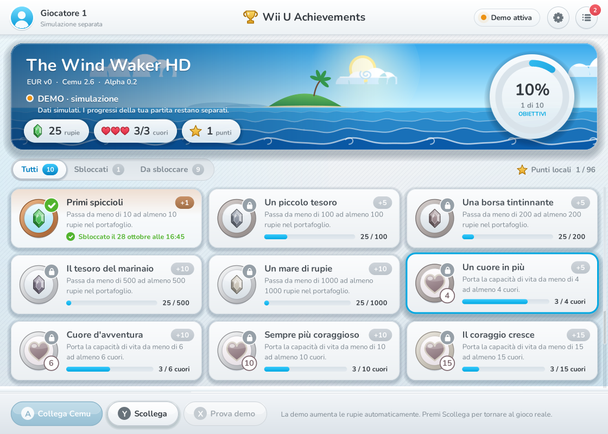
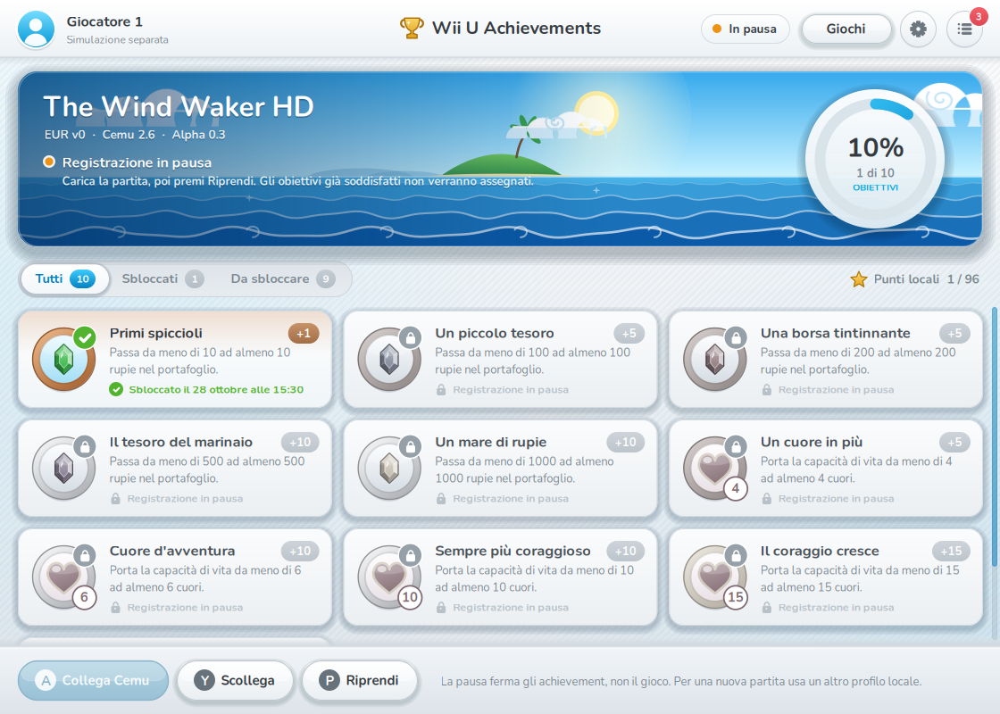
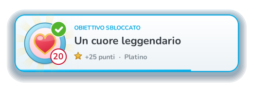
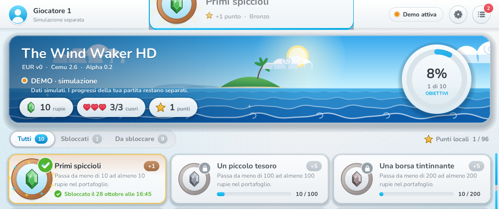
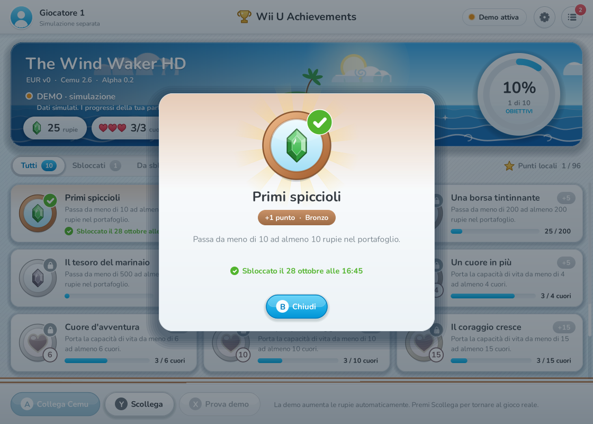
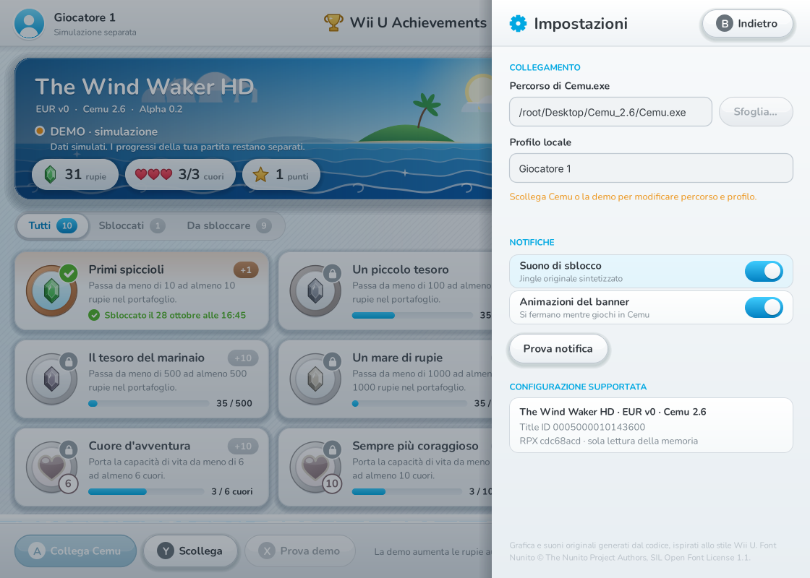

# User interface (alpha 0.3)

The expanded catalog adds a fourth status tab, **Da verificare**, and a category
cycle button (**C**). The six categories are Storia, Equipaggiamento,
Esplorazione, Collezioni, Secondarie and Crescita. Status and category filters
combine. The ring and point total include only the 70 executable objectives,
including 53 explicit experiments. The 40 pending cards display `?` instead of claimable points, an orange **Non attivo**
label, and a detail explanation of the missing verification. Accessibility help
includes the category, pending requirement and explicit absence of automatic
unlocks. No pending card queries snapshot
fields or changes recording state.

**Tappa / F** cycles the chronological groups, independently of **Categoria / C**.
The default list starts with the tunic, telescope, sword and shield and follows
the approximate playthrough order; growth thresholds are at the end. Metadata
never prevent free exploration. Experimental cards use a `*` in the points pill,
explicit detail text and a marked unlock notification. They can unlock; pending
cards cannot. The title banner identifies this build as **Playthrough TEST**.

The window and the unlock popup are custom-drawn WinForms surfaces styled after
the light Wii U system menus: a pale striped backdrop, white rounded cards, pill
buttons with GamePad face-button glyphs (A/B/X/Y), a cyan selection cursor and a
cel-shaded sea banner for the game.

## Asset policy

- **No Nintendo files.** Every shape (gems, hearts, medals, trophy, clouds,
  waves, island, avatar, icons) is drawn with GDI+ in code. Nothing was ripped
  from the console, a game or a website. Do not add Nintendo logos, Miis, menu
  textures, sounds or the proprietary system font.
- **Font:** Nunito Regular/Bold/ExtraBold, © The Nunito Project Authors, SIL Open
  Font License 1.1 (`assets/fonts/OFL.txt`). The three static TTFs come from the
  Google Fonts API. `build.ps1` embeds them as manifest resources named
  `WiiUAchievements.Fonts.<file>`. Keep `OFL.txt` next to the fonts.
- **Sound:** `Chime.Build()` creates a three-note bell arpeggio (C6–G6–C7) as an
  in-memory 16-bit WAV. There is no sound file.

## Source map

| File | Responsibility |
| --- | --- |
| `src/MainForm.cs` | Session logic: connect, demo, sampling, settings, toast queue. Catalog/profile routing, recording pause/resume and engine state updates. |
| `src/MainForm.Ui.cs` | Layout, painting, animation timer, mouse/keyboard input and accessibility of the main window. |
| `src/MainForm.Tiles.cs` | Bounded lazy bitmap cache for static achievement cards; live footers and animated cards remain dynamic. |
| `src/MainForm.Library.cs` | Game catalog using the same rounded cards, sea artwork and input widgets. |
| `src/Theme.cs` | Palette, fonts, easing, text helpers, rounded shapes, shadows, cursor and every vector icon/medal. `Art` maps a rule to its medal. |
| `src/Banner.cs` | `OceanBanner`: cached sky layer plus animated clouds, swell rows, foam and sparkles. |
| `src/Notification.cs` | `ToastForm` unlock popup, `Layered` (UpdateLayeredWindow) and `Chime`. |

## Rendering model

- Layout uses a 96-DPI logical canvas. `scale = DpiX / 96` is applied once with
  `ScaleTransform`. Mouse coordinates are divided by the same factor.
- `Arrange()` rebuilds the visible widget list (buttons, tabs, tiles, toggles,
  fields) on every paint and hit test. Widgets keep the same identity by id, so
  hover/press animation state survives a relayout.
- `Render()` draws the cached backdrop, then grid, tabs, banner, top bar, log
  drawer, bottom bar, settings sheet and detail dialog. Each layer is skipped
  when it lies outside the invalidated rectangle.
- A 15 ms `animation` timer advances hover/press, sheet/drawer/dialog transitions,
  the tab highlight, smooth scrolling, the progress ring, the rupee counter,
  staggered tile intros and unlock celebrations. It stops itself when nothing
  moves. Ambient motion (banner sea, status-dot pulse, focus pulse) runs only while
  this window is the active window and the setting is enabled. It pauses while
  the player is in Cemu, so it uses no CPU then.
- Scrolling invalidates only the grid while other UI state is steady. Static
  cards (background, shadow, medal, title, description, point pill) are rasterized
  lazily at device resolution and reused. A 48-entry least-recently-used cache
  bounds native bitmap memory and disposes replaced/evicted entries. Resize,
  game selection and form disposal clear it. Unlock state changes rebuild the
  corresponding image. Progress/status footers are drawn live every frame;
  hovered/focused/pressed or celebrating cards retain vector animation. The
  intro stagger counts viewport cards so scrolling far down a long list does
  not introduce a delay proportional to the achievement's catalog index.
- The sampling timer remains 100 ms. Pause stops it; resume establishes a new
  baseline. Per-rule confirmation and blocked states come directly from the engine.

## Achievement visuals

`Art.For(rule, allRules)` derives the medal without new XML fields:

- `rupees` → a faceted gem whose colour follows the rule's rank among rupee
  thresholds: green, blue, red, purple, gold, then silver.
- `max_health` → a heart container with the heart count as a badge.
- Medal tier comes from explicit editorial rarity, independently of points.
  See `RARITIES.md`: 53 bronze, 47 silver, 10 gold; platinum is reserved for the
  future set-completion trophy. The name appears below the medal and in the
  detail pill, including when a rule is experimental or not active.
- Locked medals are desaturated and carry a lock badge. Unlocked medals get a
  green check and a tier-tinted card.

Tile footer states:

- **Unlocked:** local date and time.
- **No data:** "Da sbloccare".
- **Live below threshold:** progress bar and value.
- **Baseline settling below threshold:** "Sincronizzazione…".
- **At or above threshold during confirmation:** "Verifica 1/3", then "Verifica 2/3".
- **At or above threshold without a stable lower baseline:** "Soglia già raggiunta
  all’avvio". These states come from `AchievementEngine.Status`; no duplicate
  baseline logic lives in the interface.
- **Paused:** "Registrazione in pausa" for locked objectives; saved objectives
  keep their date, points and medal.

An unlock plays a 1.8 s celebration on its tile: medal pop, rays, sparkles, a
shine sweep and a gold edge. The ring and counters also animate.

## Game catalog and recording pause

**Giochi** in the top bar, or **G**, opens a separate catalog view. The existing
main screen, theme, Nunito fonts, sea artwork, medals and popup are preserved.
The catalog shares the widget, focus and accessibility infrastructure, including
disabled states for unavailable titles. It scrolls when further rows are added.
See `GAMES.md` for the adapter/registration boundary.

While attached, **Pausa / Riprendi** replaces the disconnected-only **Prova demo**
button in the same bottom-bar space. **P** operates it from the objectives view.
The program explicitly says the game continues during recording pause. Catalog
navigation does not alter recording state. **B / Esc** closes the top surface
(settings, detail, drawer) and then returns from the catalog.

## Unlock popup

- A top-most `WS_EX_LAYERED | WS_EX_TRANSPARENT | WS_EX_NOACTIVATE |
  WS_EX_TOOLWINDOW` window updated through `UpdateLayeredWindow`. This gives
  per-pixel alpha (soft shadow, glow, rounded corners). It never takes focus,
  and clicks pass through it to the game.
- It appears top-centre on the monitor that shows Cemu's main window. Demo and
  preview popups appear on the app's monitor.
- Timeline (5.4 s): slide down with overshoot, medal pop, rotating rays,
  sparkles, text reveal, shine sweep, a countdown bar, then slide up and fade.
- If `UpdateLayeredWindow` fails, `Layered.Disabled` is set. The same unlock is
  then shown again in a plain rounded popup with opacity fades. Non-Windows
  runtimes always use that fallback.
- "Prova notifica" in the settings panel queues a preview popup labelled
  "ANTEPRIMA". Use it to check that popups appear over the game in the chosen
  Cemu fullscreen mode.

## Input and accessibility

| Input | Action |
| --- | --- |
| Mouse | Hover shows the cyan cursor. Click a tile for the detail dialog. Wheel scrolls the grid or the log. |
| Tab / Shift+Tab | Move focus through the controls in the active layer, text fields included. |
| Arrow keys | Spatial navigation (nearest control in that direction), like the Wii U Menu. |
| Enter / Space | Activate the focused control. |
| A / X / Y | Connect Cemu / start demo / disconnect, when no panel is open. |
| B / Esc / Backspace | Close the dialog, the settings panel or the log, in that order. |
| Page Up / Page Down | Scroll the grid. |

The form overrides `CreateAccessibilityInstance`. Each drawn control is exposed
as an `AccessibleObject` with a name, role, state, screen bounds and a default
action. The real text boxes are exposed through their own accessibility objects.
The status text is mirrored in the form's `AccessibleDescription`.

## Settings

`data/settings.xml` remembers the selected catalog ID in `<game>` and keeps the
two optional UI elements: `<sound>` and `<ambient>`, both
`true`/`false`. Older files without them load with both enabled. The settings
panel saves immediately when a toggle changes. The Cemu path and profile remain
read-only while a session or the demo is running. Progress identity and the
achievement set revision (`wwhd-alpha-1`) are unchanged.

## Developer aids

- `tests/run-ui.ps1`: isolated no-Cemu UI smoke suite and full/minimum-size PNGs.
- `--preview=<png>`: renders the main window after 1.2 s, then exits. It uses
  the same `Render()` path, not a screen grab.
- `--preview-toast=<png>`: renders one popup frame with transparency, then exits.

Screenshots in `docs/screenshots/` were rendered under Mono/libgdiplus on Linux
(Xvfb) with Nunito installed. Windows text antialiasing differs slightly.

| | |
| --- | --- |
|  |  |
|  | |
